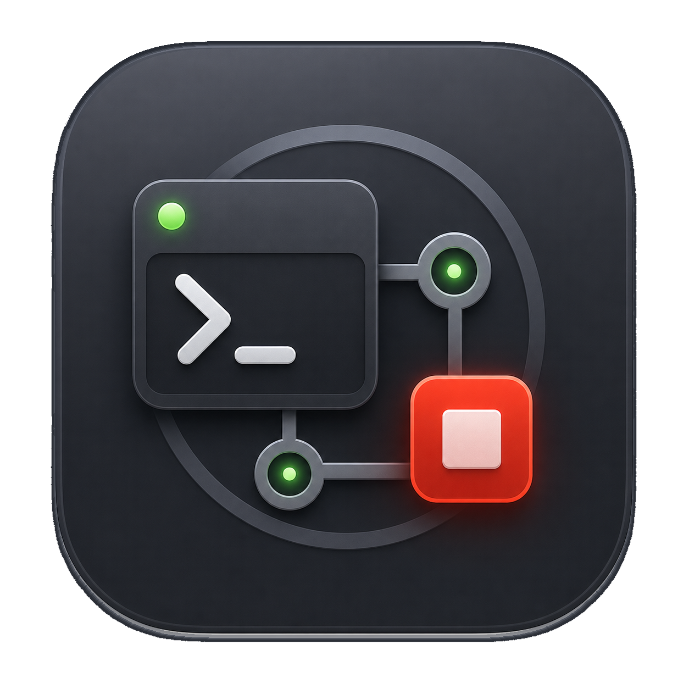
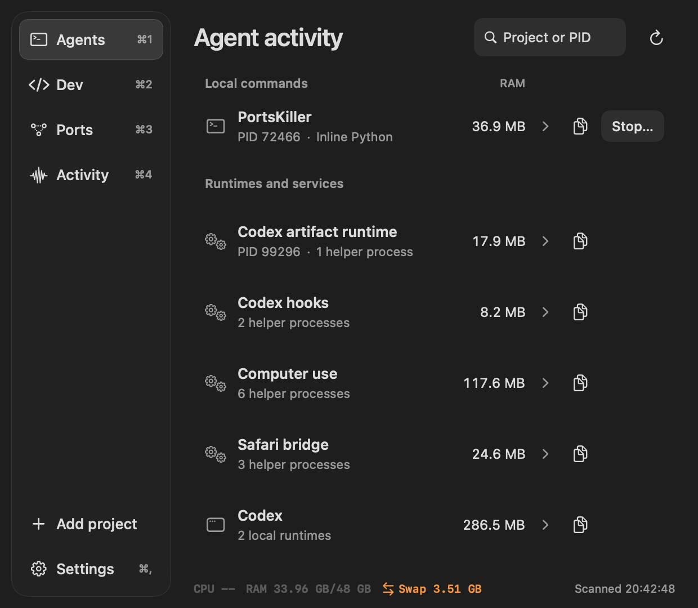

<p align="center">
  
</p>

<h1 align="center">PortsKiller</h1>

<p align="center">A macOS menu bar app for quitting running apps, seeing what Codex is running locally, and freeing up development ports.</p>

<p align="center">
  <a href="https://github.com/iddictive/PortsKiller/releases/latest">Download for macOS</a> ·
  <a href="#quick-start">Quick start</a> ·
  <a href="#build-from-source">Build from source</a> ·
  <a href="CHANGELOG.md">Changelog</a> ·
  <a href="#русский">Русский</a>
</p>

<p align="center">
  
</p>

## Quick start

1. Download the DMG from [GitHub Releases](https://github.com/iddictive/PortsKiller/releases/latest).
2. Drag PortsKiller to Applications and open it.
3. **Right-click** the menu bar icon to find a running app and quit it. **Left-click** to open the process window.

The release DMG is for Apple silicon on macOS 13 or later. The app is ad-hoc signed, not notarized. macOS may ask you to approve the first launch.

## Find what’s running

**Running apps.** Right-click the menu bar icon, type an app’s name, and choose **Quit**. PortsKiller asks the app to quit normally, so the app can still prompt to save your work. It won’t force quit.

**Agents.** See local commands PortsKiller can trace to Codex. Search by command, project, or PID, or click **RAM** to sort each group by memory. Expand a row to see what’s running, when it started, its CPU and memory, and the process IDs you can copy. Eligible command groups can be stopped after confirmation. Codex and helper services, such as Computer Use, hooks, and the artifact runtime, appear separately and are read-only. This view observes local processes. It does not read chats or show cloud task status.

**Dev** shows likely development servers and **Ports** lists detected TCP listeners. Find what owns a port, open the localhost URL, reveal the project folder, or stop an eligible process. **Activity** shows resource-heavy local processes, simulators, and emulators even when they don’t listen on a port. For a quick resource check, the menu bar can show CPU or RAM.

## Run a project again

Open **Add Project**, pick a folder, and choose a launch command. For projects with a `package.json`, PortsKiller offers the available scripts and uses lockfiles to suggest npm, pnpm, yarn, or bun. Start or restart a saved project from the same window. Commands run with your installed tools, and PortsKiller shows stdout and stderr for processes it starts.

If PortsKiller can’t infer a restart command for an existing listener, open project setup from its row to add one. **Settings** is where you manage saved projects, menu bar metrics, and updates. Updates for the copy in Applications show release notes and ask before installing.

## Build from source

Use macOS 13 or later, Xcode Command Line Tools, and Swift 6:

```bash
swift build
swift test
scripts/build-app.sh
open .build/PortsKiller.app --args --show-agents
```

The packaging script writes the app bundle and a versioned DMG to `.build/`. Set `PORTSKILLER_VERSION` to package a specific version locally. The [release workflow](.github/workflows/release.yml) packages and publishes the DMG on GitHub.

To inspect the same local scanner data without opening the window:

```bash
swift run PortsKiller --scan-agents
swift run PortsKiller --scan-once    # likely development listeners
swift run PortsKiller --scan-all     # all detected TCP listeners
swift run PortsKiller --scan-activity
swift run PortsKiller --system-stats
```

---

<a id="русский"></a>

## Русский

PortsKiller живёт в строке меню macOS. Правый клик открывает поиск по запущенным приложениям и кнопку **Quit**. Это обычное завершение: приложение может предложить сохранить изменения, принудительно его никто не закроет.

Левый клик открывает окно процессов. Во вкладке **Agents** видно, какие команды Codex запустил на этом Mac. Список можно искать и сортировать по RAM, а в раскрытой строке посмотреть контекст, время запуска и PID. Рантаймы и служебные процессы вынесены отдельно, останавливать их через **Agents** нельзя. Содержимое чатов и состояние облачных задач здесь не отображаются.

**Dev** показывает вероятные серверы разработки, **Ports** — найденные TCP-порты, **Activity** — тяжёлые процессы, симуляторы и эмуляторы. Через **Add Project** можно сохранить папку и команду, чтобы запускать проект из того же окна и видеть его логи.

[Скачать DMG](https://github.com/iddictive/PortsKiller/releases/latest) · macOS 13 или новее. Перенесите приложение в Applications. При первом запуске macOS может запросить подтверждение.
